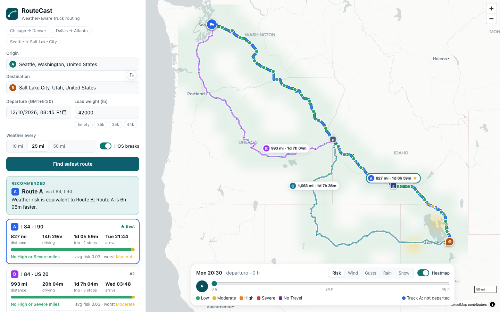

# RouteCast · Weather-Aware Truck Routing

A React + Django app that helps a truck driver pick the safest route from weather, load weight and travel time.

**Live demo:** https://routecast-8pwa.onrender.com · **Walkthrough:** _add your Loom link here_

> Hosted on Render's free plan: the first visit after ~15 idle minutes takes 30–60 s while the service wakes up.



## What it does

| Requirement | How it's met |
| --- | --- |
| Origin, destination, departure, load weight | Place autocomplete (Photon, with Nominatim fallback), `datetime-local` departure, load in lb with quick presets |
| **3 route options** from a routing API | OSRM alternatives. When OSRM returns fewer than 3, extra candidates are forced through via-points offset sideways from the fastest route, then filtered for distinctness (≤80% overlap), detour size (≤1.6× the fastest) and loops/doubling-back |
| Weather every **10 / 25 / 50 mi** at the truck's **ETA** | Checkpoints at 0, N, 2N … plus the destination. Each ETA comes from a truck timeline (OSRM segment times, 65 mph cap, optional HOS breaks). The forecast is read for that exact time |
| Risk from the **threshold table + load rules** | `backend/routing/services/risk.py`: pure functions with boundary tests |
| **Recommend** the best route | Ranked by No Travel → Severe → High miles → average risk → travel time, with tolerances (see below). The UI says which criterion decided |
| Routes, checkpoints, risk levels, ETAs, summaries **on a map** | MapLibre GL (WebGL): all 3 routes, the selected one coloured by risk, checkpoint hover popups (ETA, wind/gust, rain, snow, which factor drove the level, any load rule), route labels, HOS stop markers, per-route cards and checkpoint timeline |
| **Heatmap** along the corridor with a **0–48 h slider** | Forecast grid within 40 mi of every route, 49 hourly frames. Layers: Risk, Wind, Gusts, Rain, Snow. Play/scrub, hover readout, and trucks that move along each route as you scrub |

Extras, kept small: FMCSA hours-of-service stops (on by default; they change downstream ETAs and therefore which forecast hour applies), a "leave N hours later" suggestion when that cuts High/Severe/No Travel miles, light/dark theme, and a mobile layout.

## Architecture

```
frontend/ (Vite + React + TS)            backend/ (Django + DRF)
 TripForm ── POST /api/plan ───────────▶ planner.build_plan
                                          ├─ routing.get_route_options  → OSRM (+ via-point alternatives)
                                          ├─ timeline.build_timeline    → truck ETAs, HOS stops
                                          ├─ weather.fetch_hourly       → Open-Meteo (batched, cached; MET Norway fallback)
                                          ├─ risk.assess                → level per checkpoint
                                          └─ recommendation.recommend   → ranking + reason
 MapView / ForecastPanel
          ── POST /api/heatmap ────────▶ heatmap.build_heatmap   → corridor grid × 49 hours
 PlaceInput ── GET /api/geocode ───────▶ geocoding.search        → Photon / Nominatim
```

* **Stateless API.** No database. The heatmap request sends back the route paths, so any instance can answer it. Third-party responses are cached in a file cache shared by all workers (routes 1 h, forecasts 30 min, geocoding 24 h).
* **Routes render first.** `/api/plan` returns routes and risk quickly (simplified geometry, about 30 KB gzipped). The heatmap loads separately.
* **Heatmap performance.** The grid is regular in Web-Mercator space, so each hour paints straight into a small canvas that MapLibre stretches over the corridor as one image source. Frames are pre-rendered during idle time and cached, so scrubbing or playing only swaps an image. There are no per-frame GeoJSON updates.

## The logic, precisely

**Checkpoints and ETAs.** Checkpoints sit every N miles along OSRM's distance annotations, plus one at the destination. A regular mark less than a mile from the destination is merged into it. OSRM's public server only has a car profile, so each road segment is slowed to at least `distance / 65 mph`. With HOS on, a 30-min break is inserted after 8 h of driving and a 10-h rest after 11 h. Each stop is placed at the exact mile where it falls, and every later ETA shifts accordingly.

**Forecast at the ETA.** Open-Meteo hourly data, requested in mph and inches:
* Wind and gusts are instantaneous values, so they are linearly interpolated between the two surrounding hours.
* Rain, showers and snowfall are *preceding-hour sums*, so the hourly value is the in/hr rate. A truck passing at 14:20 uses the 15:00 bucket.
* Rain = `rain + showers`. Open-Meteo reports convective showers separately, and leaving them out would miss thunderstorms.

**Weather provider fallback.** Open-Meteo's free tier is metered per IP address. Free hosting such as Render routes many apps through shared IPs, and those other apps can use up the daily quota. When Open-Meteo refuses, the backend switches automatically to [MET Norway's Locationforecast](https://api.met.no/weatherapi/locationforecast/2.0/documentation) for the next 10 minutes. It is free, global and metered separately. Its data is converted to the same units and hour-bucket semantics: m/s to mph, mm to inches, precipitation split into rain or snow by the forecast's weather symbol (or freezing temperature), and snow depth at a 10:1 snow-to-water ratio. On a test trip the two providers' wind differed by about 2.6 mph on average and gave the same recommendation. MET has no gust data outside the Nordics, so with the fallback, gusts show the sustained speed. Gusts are display-only either way.

Classification uses **sustained** wind. Gusts are shown alongside but not scored, because the spec's table says "Wind".

**Risk rules** (`risk.py`). Overall level = worst of load-adjusted wind, rain and snow.

| | Low | Moderate | High | Severe | No Travel |
| --- | --- | --- | --- | --- | --- |
| Wind (mph) | < 25 | [25, 35) | [35, 45) | [45, 55) | ≥ 55 |
| Rain (in/hr) | < 0.10 | [0.10, 0.25) | [0.25, 0.50) | [0.50, 1.00] | > 1.00 |
| Snow (in/hr) | < 0.5 | [0.5, 1.0) | [1.0, 2.0) | [2.0, 3.0] | > 3.0 |

The spec's ranges share endpoints (0.25 is listed under both Moderate and High), so each shared bound goes to the higher level. The No Travel cut-offs keep the spec's strict ">". Wind is continuous, so "25–34" means 34.9 mph is still Moderate.

Load rules escalate the wind level and never lower it: ≥ 55 mph → No Travel; 45–54 mph with > 30,000 lb → No Travel; 35–44 mph with > 40,000 lb → Severe. Exactly 30,000 or 40,000 lb does not trigger them, because the spec says "greater than".

**Miles per level.** Each checkpoint represents the stretch of road nearer to it than to its neighbours: half the gap on each side. Severe/High miles are sums over those stretches. Average risk is the mile-weighted mean of the level, where Low = 0 … No Travel = 4.

**Recommendation** (`recommendation.py`). Routes are compared criterion by criterion:

1. No Travel miles. This is an addition: No Travel is worse than Severe, so crossing it must never win just by having fewer Severe miles.
2. Severe miles
3. High miles
4. Average risk
5. Travel time, including HOS stops

A criterion only decides when the gap is meaningful: **more than 1 mile** for mileage, **more than 0.10** for average risk. Without the tolerance, 25 Moderate miles on a 1,000-mile trip (average 0.03 vs 0.00) would justify a 7-hour detour, which is not "balancing weather risk and travel time". If every route crosses No Travel, the least-bad route is shown with a clear warning and a delayed-departure suggestion when one exists.

## Run locally

Requirements: Python 3.12+, Node 20+. No API keys needed.

```bash
# API (http://127.0.0.1:8000)
cd backend
python3 -m venv .venv && .venv/bin/pip install -r requirements.txt
.venv/bin/python manage.py runserver

# Web (http://localhost:5173, proxies /api to :8000)
cd frontend
npm install
npm run dev
```

Tests and lint:

```bash
cd backend && .venv/bin/python manage.py test routing     # 50 tests, no network needed
cd frontend && npx tsc -b && npx eslint src
```

The tests cover every threshold boundary, each load rule, ranking order and tolerances, HOS stop placement, forecast-hour selection, checkpoint mileage, and an end-to-end plan with routing and weather stubbed.

## Deploy

One Docker image builds the React app and serves it together with the API (gunicorn + WhiteNoise, pre-compressed, immutable-cached assets).

* **Render:** New → Blueprint → select this repo (`render.yaml`). It deploys on the free plan.
* **Anywhere with Docker:** `docker build -t routecast . && docker run -p 8000:8000 -e DJANGO_SECRET_KEY=change-me -e DJANGO_ALLOWED_HOSTS=your.host routecast`

| Env var | Default | Purpose |
| --- | --- | --- |
| `DJANGO_SECRET_KEY` | dev key | Required in production |
| `DJANGO_DEBUG` | `1` locally, `0` in Docker | |
| `DJANGO_ALLOWED_HOSTS` | `localhost,127.0.0.1,.onrender.com` | |
| `OPEN_METEO_API_KEY` | – | Optional commercial key (higher rate limits) |
| `OSRM_BASE_URL` | public demo server | Point at your own OSRM for production use |

## API

`POST /api/plan`
```json
{ "origin": {"label": "Chicago", "lat": 41.88, "lon": -87.63},
  "destination": {"label": "Denver", "lat": 39.74, "lon": -104.98},
  "departure": "2026-10-13T14:00:00Z", "load_lbs": 42000, "interval_mi": 25, "hos": true }
```
Returns `routes[]` (geometry, per-vertex miles and seconds, checkpoints with weather and risk, HOS stops, miles per level, a departure scan), `recommendation` (winner, ranking, reasons) and `departure_advice`.

`POST /api/heatmap` takes `{ paths, departure, load_lbs }` and returns the grid bbox, cols/rows, corridor cell indices, 49 hourly timestamps and per-layer values.
`GET /api/geocode?q=…` · `GET /api/health`

## Limitations and next steps

* **Car routing, adjusted for trucks.** The public OSRM server has no HGV profile, so there are no truck restrictions (bridge heights, hazmat). Swapping in an HGV-capable router such as OpenRouteService `driving-hgv`, GraphHopper or HERE only touches `routing.py`.
* **Free-tier limits.** Open-Meteo's free tier allows about 600 location-calls per minute. A long trip at 10-mile spacing uses a few hundred (checkpoints are snapped to about 3.5 mi and de-duplicated; the heatmap is capped at 160 cells; responses are cached and shared across server workers). Set `OPEN_METEO_API_KEY` for heavy use.
* **Forecast window.** Departures can be up to 7 days out, inside the 16-day forecast range.
* **Display time zone.** Times show in the viewer's time zone, which is labelled next to the departure field.
